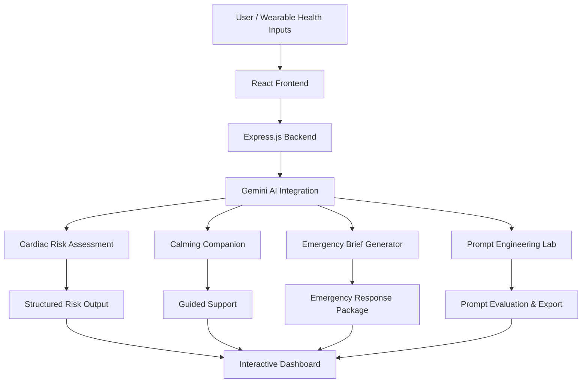

# ❤️ CardioCalm — AI-Powered Personal Cardiac Health Agent

<p align="center">

  **Predict Early. Stay Calm. Respond Faster.**

  An AI-powered cardiac health triage prototype that combines early risk assessment, patient calming, and emergency response coordination.

  Built for **PromptWars X AI Vibeathon 2026**  
  📅 November 25, 2026

</p>

---

## 🚀 Overview

Cardiac emergencies can escalate within minutes. Recognizing early warning signals, responding calmly, and communicating critical information to emergency responders can make a meaningful difference.

**CardioCalm** is a full-stack AI health triage prototype designed to demonstrate how intelligent AI agents can support three critical stages of cardiac safety:

1. **Predict** — Analyze wearable health metrics and reported symptoms to identify potential cardiac risk signals.
2. **Calm** — Provide context-aware emotional support and guided breathing during stressful situations.
3. **Respond** — Prepare structured emergency information to help patients and caregivers communicate effectively with emergency services.

Powered by **Google Gemini AI**, CardioCalm brings these capabilities together in one interactive platform, alongside a dedicated Prompt Engineering Lab for experimentation, evaluation, and hackathon submission preparation.

> **Our vision:** Turn scattered health signals into actionable awareness, panic into calm, and emergency information into coordinated communication.

---

## ✨ Key Features

### 1. 🫀 Early Cardiac Risk Prediction

**API:** `/api/gemini/cardiac-assess`

CardioCalm analyzes wearable health metrics, symptoms, and activity context to generate a structured cardiac risk assessment.

**Input parameters:**
- Heart Rate (BPM)
- Heart Rate Variability (HRV RMSSD)
- Systolic and Diastolic Blood Pressure
- Blood Oxygen Saturation (SpO₂)
- Self-reported symptoms
- Recent physical activity and contextual information

**Core capabilities:**
- AI-assisted risk classification:
  - 🟢 Nominal
  - 🟡 Elevated
  - 🔴 High Alert
- Early warning signal identification
- Immediate safety guidance
- Recommended escalation actions
- Structured JSON assessment output
- Live Lead II ECG-style visualization
- Interactive clinical simulation presets:
  - Resting Baseline
  - Pre-Event Warning
  - Acute Cardiac Alert

### 2. 🧘 Patient Calming & Guided Breathing

**API:** `/api/gemini/calm-chat`

A cardiac health event can create fear, confusion, and panic. CardioCalm includes an AI-powered calming companion designed to provide short, grounded, and supportive communication.

**Features:**
- Context-aware Gemini-powered conversation
- Responses adapted to the current triage context
- Short, clear, non-alarmist language
- Interactive 4-7-8 breathing pacer

**Guided breathing cycle:**

| Phase | Duration |
|---|---:|
| Inhale | 4 seconds |
| Hold | 7 seconds |
| Exhale | 8 seconds |

The breathing interface is intended as a relaxation aid, not an intervention for suspected cardiac emergencies. It must never delay emergency care.

### 3. 🚑 Emergency Response Coordination

**API:** `/api/gemini/dispatch-brief`

When an emergency is suspected, communicating the right information quickly is essential.

CardioCalm generates an organized emergency response package containing:

**EMS Dispatcher Summary**
- Current vital signs
- Reported symptoms
- Relevant medical history
- Known allergies
- Emergency access instructions

**Emergency Contact Alert**
- Ready-to-edit SMS notification draft
- Concise summary of the situation
- Relevant information for family members or caregivers

**Responder Readiness Checklist**
- Important information to prepare
- Emergency access considerations
- Essential communication reminders

Includes one-click copy functionality for generated summaries and alerts.

*The prototype prepares information but does not independently contact emergency services or dispatch an ambulance.*

### 4. 🧪 Prompt Engineering Lab

**APIs:**
- `/api/gemini/run`
- `/api/gemini/critique`
- `/api/gemini/polish`

An integrated prompt engineering workspace designed for experimentation and hackathon evaluation.

**Features:**
- Interactive sprint countdown timer
- Reusable prompt engineering patterns
- AI-powered prompt execution
- Structured AI judge critique
- Prompt refinement and polishing
- Revision comparison history
- Markdown and JSON submission export
- Hack2Skill submission packager

This module demonstrates how prompt engineering can be used to improve structured AI outputs, clarity, consistency, and usability.

---

## 🏗️ System Architecture



---

## 🛠️ Tech Stack

| Layer | Technology |
|---|---|
| Frontend | React 19 |
| Language | TypeScript |
| Styling | Tailwind CSS v4 |
| Animations | Motion |
| Icons | Lucide Icons |
| Backend | Node.js + Express.js |
| Development Server | Vite |
| AI Integration | Google Gemini API |
| AI SDK | `@google/genai` |
| AI Model | Gemini 4 Hydrogen |

---

## 📂 Project Structure

```text
CardioCalm/
│
├── src/
│   ├── components/          # Reusable UI components
│   ├── pages/               # Application pages
│   ├── hooks/               # Custom React hooks
│   ├── services/            # Frontend API integrations
│   ├── utils/               # Helper functions
│   └── ...
│
├── server.ts                # Express backend
├── package.json             # Dependencies and scripts
├── index.html               # Application entry point
├── vite.config.ts           # Vite configuration
├── tsconfig.json            # TypeScript configuration
├── .env.example             # Environment variable template
└── README.md
```


## ⚙️ Getting Started

### Prerequisites

Make sure you have:

- Node.js (LTS recommended)
- npm
- A Google Gemini API key

### 1. Clone the Repository

```bash
git clone <YOUR_GITHUB_REPOSITORY_URL>
cd CardioCalm
```

### 2. Install Dependencies

```bash
npm install
```

### 3. Configure Environment Variables

Create a `.env` file in the project root:

```env
GEMINI_API_KEY=your_google_gemini_api_key
```

### 4. Start the Development Server

```bash
npm run dev
```

Open the local URL displayed in your terminal.

### 5. Explore CardioCalm

Try the three cardiac simulation presets, interact with the calming companion, generate an emergency dispatch brief, and experiment with the Prompt Lab.

---

## 🔌 API Reference

| Endpoint | Method | Purpose |
|---|---|---|
| `/api/gemini/cardiac-assess` | POST | AI-assisted cardiac risk assessment |
| `/api/gemini/calm-chat` | POST | Context-aware calming conversation |
| `/api/gemini/dispatch-brief` | POST | Emergency response brief generation |
| `/api/gemini/run` | POST | Execute prompts |
| `/api/gemini/critique` | POST | Evaluate prompt quality |
| `/api/gemini/polish` | POST | Refine and improve prompts |

---

## 💡 What Makes CardioCalm Different?

CardioCalm is built around a three-stage approach rather than treating cardiac health as a single prediction problem.

| Challenge | CardioCalm Approach |
|---|---|
| Recognizing warning signals | AI-assisted cardiac risk assessment |
| Managing panic and uncertainty | Context-aware calming companion |
| Communicating during emergencies | Structured dispatcher and contact briefs |
| Improving AI reliability | Prompt Engineering Lab |

**The core innovation is integration:** bringing risk awareness, supportive communication, and emergency information preparation into one coherent experience.

---

## 🔐 Safety, Privacy & Responsible AI

CardioCalm is an experimental hackathon prototype.

- It is not a certified medical device.
- AI-generated risk classifications are not clinical diagnoses.
- Wearable measurements may be inaccurate or incomplete.
- The system cannot reliably predict or rule out heart attacks.
- AI-generated guidance must not replace a qualified medical professional.
- Do not use simulated ECG signals as real diagnostic evidence.
- Do not delay emergency medical care to interact with the application.

**Emergency Warning:** If you experience chest pain, difficulty breathing, fainting, sudden weakness, or other potentially serious acute symptoms, contact your local emergency services immediately.

The prototype should use secure handling of health information, avoid unnecessary storage of sensitive data, and never expose API credentials.

---

## 🔮 Future Scope

Potential enhancements include:

- Real-time wearable integrations with supported smartwatch platforms.
- Continuous vital-sign monitoring with validated alert thresholds.
- Clinically validated risk-assessment protocols.
- Multilingual voice-based emergency assistance.
- Location-aware emergency contact workflows with user consent.
- Secure caregiver dashboards.
- Integration with authorized healthcare providers.
- Improved explainability and evaluation of AI-generated assessments.
- Robust testing against missing, noisy, and inconsistent sensor readings.

---

## 🏆 Hackathon Submission

**Event:** PromptWars X AI Vibeathon 2026  
**Project:** CardioCalm  
**Category:** AI-Powered Healthcare / Agentic AI  
**Core AI Technology:** Google Gemini AI  
**Development Stack:** React, TypeScript, Express.js, and Google GenAI SDK

**Live Demo:** https://promptwars-studio.ai.studio

**GitHub Repository:** https://github.com/prachimahajan192008/cardiocalm-ai.

---

## ❤️ Final Note

CardioCalm explores a simple but important idea:

**In a cardiac emergency, intelligence should do more than analyze data. It should help people understand what is happening, stay supported, and communicate critical information faster.**

Built with AI, designed around human needs.

**CardioCalm — Predict Early. Stay Calm. Respond Faster.**

---

*Disclaimer: This project is developed for educational, research, and hackathon demonstration purposes only. It does not provide medical diagnosis, treatment, or emergency dispatch services.*
